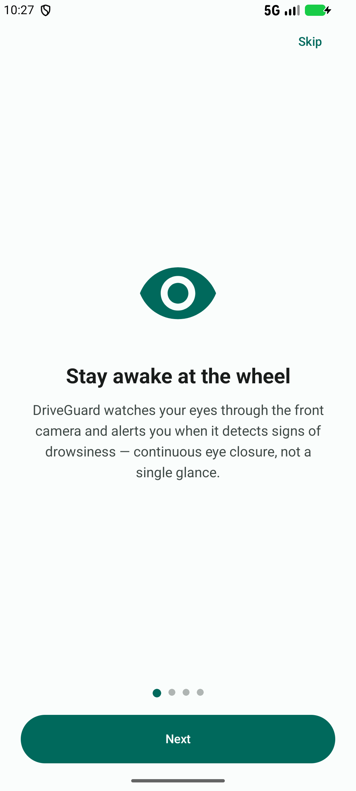
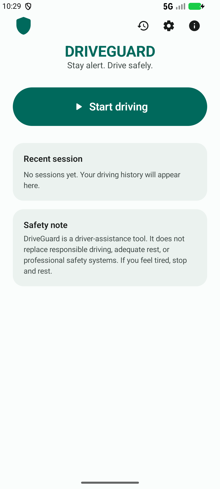
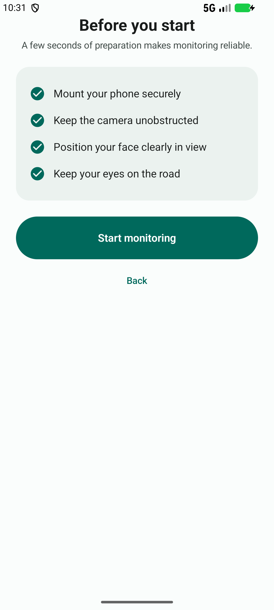
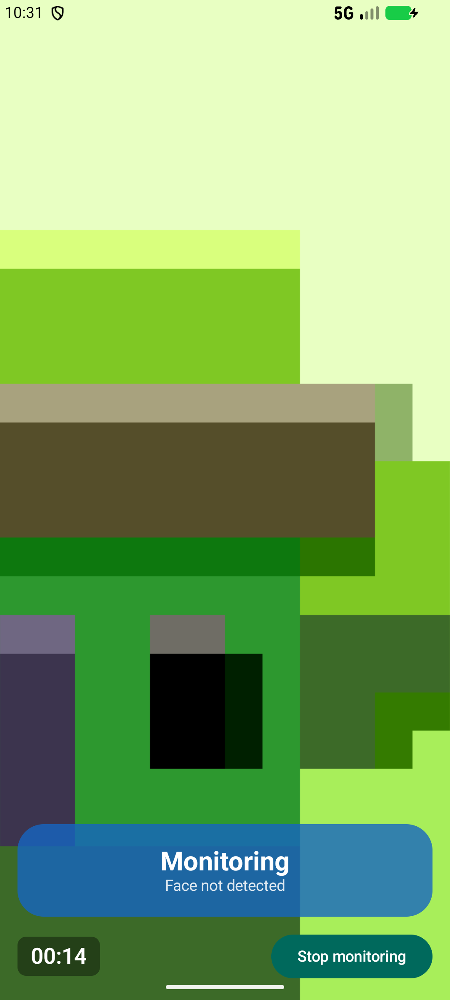
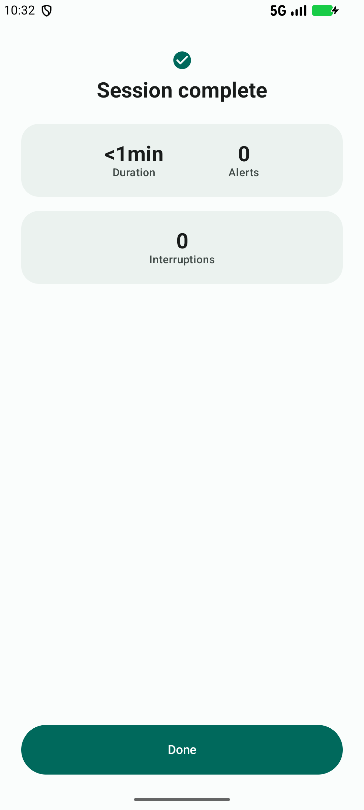
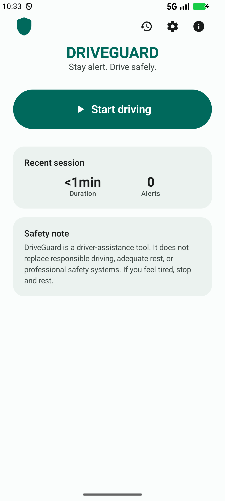

# DriveGuard — Real-Time Driver Drowsiness Detection

DriveGuard is an Android driver-assistance application that watches the driver's
eyes through the front camera and raises escalating alerts when it detects
sustained eye closure — a widely used proxy for drowsiness. All processing is
performed **entirely on-device**: the app has no network permission, no
accounts, no analytics and no ads.

> **Safety disclaimer.** DriveGuard is an assistance tool, not a safety system.
> It does not replace responsible driving, adequate rest, or professional
> driver-monitoring systems. It can miss events or raise false alerts. No
> accuracy claim is made for the bundled model.

---

## Features

- **Real-time eye-state monitoring** — ML Kit's per-eye openness probability
  drives the eye state at camera rate (a single, calibrated signal — no second
  classifier in the frame path), with the temporal decision engine enforcing a
  2-second continuous-closure rule before alerting (1.5–3 s selectable).
- **Escalating alerts** — Level 1 *"Stay Alert"* → Level 2 *"Drowsiness
  Detected"* → Level 3 *"Please stop and rest"*, with visual, audible (alarm
  stream + audio focus) and vibratory output, cooldown and hysteresis.
- **Face-aware pipeline** — ML Kit face detection gates the classifier;
  analyzer-level tracking bridges brief detection gaps, a 2 s grace window
  freezes evidence across short occlusions, and the UI distinguishes
  *Face detected / Temporarily lost / Not detected*.
- **Picture-in-picture** — Back or Home while monitoring shrinks the session
  into a floating mini window (9:16, status + timer, stop remote action);
  detection keeps running and tapping the window returns to full screen.
- **Session records** — duration, alert count, monitoring interruptions and
  measured average inference latency, stored locally (Room), viewable and
  deletable.
- **Polished UX** — onboarding, pre-drive checklist, glanceable driving screen,
  session summary, history, settings (sensitivity / alerts / appearance),
  privacy page; full dark mode; TalkBack labels throughout.

## Architecture

```
┌──────────────────────────── Android app (single module) ────────────────────────────┐
│                                                                                     │
│  ui/            Compose screens + ViewModels (StateFlow, Navigation)                │
│    │  Home · Onboarding · PreCheck · Driving · Summary · History · Settings ·       │
│    │  About · Privacy        MonitoringViewModel = session orchestrator             │
│    ▼                                                                                │
│  camera/        CameraX ImageAnalysis (KEEP_ONLY_LATEST, single-thread executor)    │
│    │            DrowsinessFrameAnalyzer (ML Kit face + openness → verdict)          │
│    ▼                                                                                │
│  ml/            EyeStateClassifier.combineEyes (agreement-aware)                    │
│    ▼                                                                                │
│  detection/     DrowsinessDetector (temporal state machine) · DrowsinessConfig      │
│    ▼            Sensitivity presets                                                 │
│  alerts/        AlertEngine (escalation) → AlertPlayer (SoundPlayer + Vibrator)     │
│    ▼                                                                                │
│  service/       MonitoringService — camera-type foreground service + notification   │
│    ▼                                                                                │
│  data/          Room (sessions) · DataStore (settings) · SessionRecorder (metrics)  │
└─────────────────────────────────────────────────────────────────────────────────────┘
```

Frame path per analysis frame:

```
CameraX (front camera, YUV_420_888)
  → ML Kit face detection (bundled, fast mode)
  → ML Kit eye openness → P(closed) = 1 − openness, per eye
     (an eye ML Kit cannot score counts as open — no fallback classifier)
  → agreement-aware combination → DrowsinessDetector (temporal rules)
  → AlertEngine → UI/alerts
```

## Technology stack

| Layer | Choice |
|---|---|
| Language | Kotlin 2.2, Coroutines, StateFlow |
| UI | Jetpack Compose + Material 3, Navigation-Compose, splash screen |
| Camera | CameraX 1.6 (Preview + ImageAnalysis, `STRATEGY_KEEP_ONLY_LATEST`) |
| Face detection & eye state | ML Kit Face Detection 16.1 (bundled — fully offline) |
| Persistence | Room 2.8 (session history), DataStore Preferences (settings) |
| Min / target SDK | 26 / 36 (compiled against 37 per navigation dependency) |

## Model information

> The detector no longer consults the bundled model: eye state comes entirely
> from ML Kit's openness signal (see *Drowsiness algorithm*). The model and its
> LiteRT runtime are still packaged but are dead weight in the frame path.

`app/src/main/assets/models/eye_model.tflite` (2,737,336 bytes) — supplied,
unmodified. Forensics (direct flatbuffer parsing + desktop inference, see
[`docs/MODEL_CONTRACT.md`](docs/MODEL_CONTRACT.md)) established:

- **Architecture**: 3× [Conv2D 3×3 + ReLU → MaxPool 2×2] (32/64/128 ch) →
  Flatten → Dense(4608→128, ReLU) → Dense(128→1) → Sigmoid. **683,329
  parameters**, all float32 — no quantization.
- **Input**: `[1, 64, 64, 3]` fp32, RGB, range `[0, 1]` (divide by 255), upright crop.
- **Output**: `[1, 1]` fp32 = **P(eye closed)** — polarity verified empirically
  (sliding-window activation on a closed-eye probe image saturates at 1.0 on
  the eyes; Haar-verified open eyes read ≈ 0).
- **No metadata buffer**: training dataset, author and license are unknown;
  therefore the app documents, and makes, **no accuracy claims**.

### Model contract (summary)

```
Input : float32[1,64,64,3]  RGB, [0,1], row-major, channel-last
        (crop of eye region; nearest-neighbour resize 64×64; x/255)
Output: float32[1,1]        P(eye closed); combined across eyes (see below)
```

The canonical test vectors in `app/src/androidTest/assets/model_test_vectors.json`
(inputs + TensorFlow-2.21-generated expected outputs) are executed **on-device**
by `ModelInstrumentedTest` to prove the contract end-to-end; all 9 vectors
reproduce within 1e-4.

## Drowsiness algorithm

`DrowsinessDetector` is a pure, deterministic state machine (clock injected):

- **Eye signal** — ML Kit's per-eye openness probability is converted to
  `P(closed) = 1 − openness`. This is the signal the validated reference
  prototype used, and the reason its alerts were stable: the probability comes
  from the same face model that found the face, so it stays calibrated in dim
  light, at an angle and with glasses. There is no fallback classifier behind
  it: an eye ML Kit reports no openness for counts as open, exactly as in the
  reference, so an unusable reading can never manufacture closure.
- **Eye combination** — the per-eye probabilities are combined so that one
  unusable reading (hair, a hand, one lid caught half-down) cannot read as a
  microsleep: if the two eyes disagree by more than 0.35 the average is used,
  which lands in the hysteresis band. The worse eye speaks for the frame only
  when both eyes agree.
- **Closed** frame: `P ≥ confidenceThreshold` (default 0.60, i.e. average eye
  openness below 0.40 — the reference cutoff; 0.50 / 0.60 / 0.70 for the HIGH /
  MEDIUM / LOW presets). A real closure sits well above 0.60; the previous 0.85
  demanded openness below 0.15, which dim light and glasses routinely fail, so
  closed eyes went undetected while partial lids still alarmed.
- **Open** frame: `P ≤ openThreshold` (0.40, i.e. average openness at least
  0.60) — the band between is *uncertain* hysteresis: it is not closure and it
  breaks an accumulated run, so hovering or squinting can never accumulate
  toward an alert.
- **Alert** fires after `closedDurationMs` (default 2 000 ms) of continuously
  closed eyes — never from a single frame. Reduced from the classic 3-second
  rule: 2 s keeps a ≥4× margin over the longest voluntary blink (~0.5 s)
  while halving alert latency; closures of ~1–2 s are treated as microsleeps
  in the PERCLOS-lineage drowsiness literature.
- **Release hysteresis** — drowsiness/alert clears only once no confidently
  closed frame has been seen for `releaseDurationMs` (700 ms, time-based, not
  frames), so blinking while drowsy never clears the state, while squinting or
  looking around does release it (a permanently latched alert would also block
  every later alert).
- **Face-loss grace** — a missing face *freezes* all evidence for
  `faceLostGraceMs` (2 s) instead of resetting it; only after 5 s of sustained
  loss is the driver considered gone (and any active alert silenced).
- **Cooldown** of 8 s between alert firings; `AlertEngine` escalates the level
  across episodes and resets after 5 clean minutes.
- **No face** never contributes to drowsiness; sustained loss resets evidence.
- *Uncertain* frames neither accumulate nor extend evidence.

## Alert system

`AlertEngine` maps episodes to `AlertLevel` 1→3 with cooldown suppression.
`AlertPlayer` renders each event: escalating vibration waveforms on the alarm
channel, and an alarm-tone playback (`RingtoneManager.TYPE_ALARM`, optional)
requested with a proper `AudioFocusRequest` (USAGE_ALARM). Both repeat for as
long as the alert stays latched, are silenced the moment the eyes are seen
open, and are re-armed if the eyes close again inside the same episode. Documented
limitation: in silent/DND mode the platform may mute the alarm stream —
vibration still runs; the app never bypasses DND.

## Privacy architecture

- The merged release manifest contains **no INTERNET or ACCESS_NETWORK_STATE
  permission** — camera data cannot leave the device even accidentally. ML Kit
  pulls `INTERNET`/`ACCESS_NETWORK_STATE` in through
  `com.google.android.datatransport:transport-backend-cct`; both are stripped
  with `tools:node="remove"` because the face model is bundled and nothing in
  the app requests the network. No cloud inference, no uploads, no analytics,
  no ads, no login.
- Removing those permissions is safe for face detection: the bundled models
  (`assets/models_bundled/blazeface.tfl`, `fssd_*`, `contours.tfl`) are inside
  the APK, so nothing is downloaded at runtime. The only shipped code that
  touches `ConnectivityManager` is DataTransport telemetry
  (`CctTransportBackend.decorate`), which runs inside
  `SafeLoggingExecutor` — a missing permission is caught and logged, the
  telemetry event is dropped, and detection is unaffected. Same configuration
  observed working on a device in
  [googlesamples/mlkit#1076](https://github.com/googlesamples/mlkit/issues/1076).
- Camera frames exist only in process memory; nothing is written to disk.
- Stored data is limited to session metrics; users can delete individual
  sessions or clear all history. See the in-app Privacy page.

## Performance methodology

- Face detection and the per-eye openness signal come from one bundled ML Kit
  pipeline on a dedicated single-thread analyzer executor — never the main
  thread. There is no second model to load or run per frame.
- `STRATEGY_KEEP_ONLY_LATEST` backpressure: under load, stale frames are
  dropped; no queue growth.
- Allocation-free steady state: the only per-frame allocation is the NV21
  array required by ML Kit.
- Per-frame analysis latency is recorded per session (`analysisMs`); no FPS
  claim is made — figures vary with device, lighting and face size.

## Testing

| Suite | Location | Count | Result |
|---|---|---|---|
| Unit (JVM) | `app/src/test` | 64 | ✅ all pass |
| Instrumented (device) | `app/src/androidTest` | 13 | ✅ all pass on emulator |

Coverage includes: temporal thresholds, hysteresis boundaries, alert fire
timing, cooldown, recovery, face-loss semantics, reset; alert escalation and
suppression; sensitivity presets; preprocessing (normalization, clamping,
layout); geometry; formatting; and **on-device model verification against the
canonical vectors**, plus end-to-end synthetic frame flows (sustained closure →
alert emission, intermittent closure → no alert, no-face → no alert, recovery
flow) and launch/recreation smoke tests. `MonitoringViewModelLifecycleTest`
(Robolectric) pins two session-lifecycle regressions: the alert player is
recreated for every session after `stop()` releases it, and a finished session
is still persisted when the ViewModel is cleared immediately after `stop()`.

## Build instructions

```bash
# requirements: JDK 17+, Android SDK (compileSdk 37 / android-37), platform 36 emulator for tests
./gradlew :app:assembleDebug            # debug APK
./gradlew :app:testDebugUnitTest        # JVM unit tests
./gradlew :app:lintDebug                # Android Lint (0 errors)
./gradlew :app:assembleRelease :app:bundleRelease   # release APK + AAB (see signing)
./gradlew :app:connectedDebugAndroidTest  # instrumented tests (device/emulator required)
```

## Release & signing instructions

Signing credentials are read **only** from environment variables and are never
committed:

| Variable | Meaning |
|---|---|
| `DG_STORE_FILE` | path to the keystore file |
| `DG_STORE_PASSWORD` | keystore password |
| `DG_KEY_ALIAS` | key alias |
| `DG_KEY_PASSWORD` | key password |

```bash
export DG_STORE_FILE=/secure/path/release.keystore
export DG_STORE_PASSWORD=…  export DG_KEY_ALIAS=…  export DG_KEY_PASSWORD=…
./gradlew :app:bundleRelease   # → app/build/outputs/bundle/release/app-release.aab
```

Without these variables the release build produces unsigned artifacts.
For local smoke-testing you may point `DG_STORE_FILE` at the debug keystore
(`~/.android/debug.keystore`, password `android`, alias `androiddebugkey`) —
**never upload debug-signed builds to Play**.

### R8 / shrinking notes

`proguard-rules.pro` keeps LiteRT's JNI surface and disables renaming of ML
Kit's internals (its Dagger graph resolves reflectively at startup; renaming
breaks `MlKitInitProvider`). The bundled `.tflite` assets survive shrinking
(verified in the release APK/AAB and by the on-device vector test).

## Release readiness

Gate status for the current tree (JDK 17, Android SDK 37):

| Gate | Command | Result |
|---|---|---|
| JVM unit tests | `./gradlew :app:testDebugUnitTest` | 64 tests pass |
| Android Lint (release) | `./gradlew :app:lintRelease` | 0 errors |
| R8 + resource shrinking | `./gradlew :app:assembleRelease` | succeeds |
| Release bundle | `./gradlew :app:bundleRelease` | `app/build/outputs/bundle/release/app-release.aab` |
| 16 KB page alignment | `zipalign -c -P 16 -v 4 <apk>` + `./scripts/check-release-permissions.sh` (libraries in the AAB) | pass (APK and AAB) |
| No network permission | `./scripts/check-release-permissions.sh` | pass (manifest, APK and AAB) |

Release artifacts ship `arm64-v8a` and `armeabi-v7a` only. LiteRT 1.0.1 binds
an `x86_64` JNI library that is 4 KB-aligned, which Play rejects for apps
targeting API 35+ on 16 KB-page devices; debug builds keep every ABI so
x86_64 emulators still install. Upgrading LiteRT to a release with 16 KB-aligned
x86_64 binaries would let that filter be removed.

`.github/workflows/android.yml` runs the unit tests, lint, the unsigned release
build and the release gate on every push and pull request. The gate
(`scripts/check-release-permissions.sh`) reads the merged release manifest, the
built release APK and the release AAB (the artifact uploaded to Play), fails if
`INTERNET` or `ACCESS_NETWORK_STATE` reappears in any of them, and prints the
permission list the APK actually ships — so a dependency bump cannot silently
break the no-network promise.

The same gate parses the ELF program headers of every native library inside the
release AAB and fails if a 64-bit library has a `PT_LOAD` segment aligned below
16384 bytes: Play builds the 16 KB-page variant from the AAB, so an unaligned
library there is just as fatal as one in the APK. 32-bit libraries are printed
for review but not failed — 32-bit devices use 4 KB pages, and LiteRT's
`armeabi-v7a` binaries are legitimately aligned to 0x1000.

Remaining owner actions before upload:

- a production upload keystore and the four `DG_*` variables (release builds are
  otherwise unsigned — verify with `keytool -printcert -jarfile app-release.aab`);
- a real contact email and a publicly hosted privacy-policy URL (the policy in
  `playstore/PRIVACY_POLICY.md` still contains a placeholder);
- clarification of the bundled model's provenance and licence;
- a real-device validation pass — the instrumented suite needs a device or
  emulator, which none of the checks above cover.

## Play Store preparation

- Primary artifact: **AAB** (`app-release.aab`).
- Store listing drafts, data-safety checklist, permission justifications and
  screenshot plan: [`playstore/`](playstore/).
- Privacy policy template: [`playstore/PRIVACY_POLICY.md`](playstore/PRIVACY_POLICY.md).

## Limitations

- The bundled model's provenance is unknown; no accuracy/sensitivity/specificity
  is claimed or implied. Users should validate behaviour in their own conditions.
- Performance depends on lighting, camera angle, glasses/sunglasses and face
  visibility; small or off-center faces degrade to "move closer" guidance.
- Alert sound may be suppressed by silent mode / DND (vibration unaffected).
- The app monitors eye closure only; it does not detect microsleeps with open
  eyes, distraction, or impairment.
- Not a medical device; not certified as automotive safety equipment.

## Screenshots

| Onboarding | Home | Pre-check |
|---|---|---|
|  |  |  |

| Driving (live) | Summary | Home (after session) |
|---|---|---|
|  |  |  |

*Screenshots captured from the release build running on an API 36.1 emulator.*

## License

Project source is provided for portfolio/educational use; see
[`LICENSE`](LICENSE). The bundled model is used as supplied; its licensing
terms are unknown (documented above).
